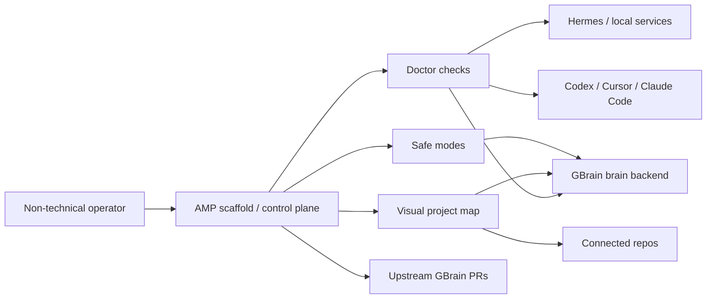

# AMP After GBrain — Strategic Pivot Decision

> **Date:** 2026-05-31  
> **Branch inspected:** `amp-11-5-optimizer`  
> **Decision owner:** Codex, for T  
> **Scope:** Strategy/product direction only. No production code changes.

---

## 1. Decision

AMP should stop trying to become an independent "brain" or memory engine.

AMP should pivot into the **scaffold, control plane, and verification harness around
agent-memory systems**, with GBrain as the primary brain backend.

Short version:

```text
GBrain is the brain.
AMP is the installer, harness, operator console, safety layer, and project explainer.
```

This keeps AMP useful without competing head-on with the layer GBrain is already
building quickly: ingestion, sync, graph traversal, search, synthesis, MCP tools,
dream cycles, schema packs, guardrails, skills, and daemon-style maintenance.

---

## 2. Why This Pivot

Recent GBrain evidence shows it is already moving into the broad platform territory
AMP would otherwise need to build:

| Evidence | Strategic meaning for AMP |
|---|---|
| GBrain README positions it as "the brain layer" with synthesis, graph traversal, gap analysis, schema packs, MCP, HTTP/OAuth, company-brain, and agent installation. | Do not build a competing memory backend. |
| Recent commits include MCP skills, guardrail seams, retrieval improvements, adaptive return sizing, stale embedding semantics, source-scoped orphan handling, type unification, doctor/status work, and source-scoped code graph fixes. | GBrain is actively filling both user-facing and infrastructure layers. |
| Latest inspected head: `248fb7a` / `v0.41.38.0`, fixing `.gbrain-source` pinning and Postgres `dream` behavior. | It is productionizing multi-source, hosted, and code-graph workflows. |
| AMP roadmap already contains GBrain capability work: procedural discovery, persistent gbrain skills path, vector-search native flip, live gbrain dogfood. | AMP is already leaning toward GBrain orchestration. Make that explicit. |

The viable wedge is not "better retrieval." The viable wedge is:

```text
Make powerful memory systems installable, inspectable, testable, explainable, and safe.
```

That is especially valuable for non-technical users and for T's own agent stack.

---

## 3. New AMP Product Shape

### 3.1 The Non-Technical User Promise

AMP should become the "one button" setup and control layer:

```text
Install Hermes / GBrain / agent clients
Connect them
Run doctor checks
Start sync
Show what is connected
Explain what is happening visually
Provide safe modes and opt-in live modes
```

For a non-technical user, AMP should answer:

- Is my brain installed?
- Is it syncing?
- Which projects/repos are connected?
- Which agent clients can see it?
- What is safe to click?
- What changed?
- What should I do next?

### 3.2 The Technical User Promise

For a technical user, AMP should be:

- a conformance harness for memory backends,
- an installer/scaffold for GBrain/Hermes/Codex/Cursor/Claude Code,
- a safety wrapper around live memory mutation,
- a dogfood runner for real workflows,
- a visual project cartographer for complex systems,
- a place to produce upstream-ready GBrain PRs.

---

## 4. Keep / Delegate / Park

### Keep In AMP

| Area | Why AMP should own it |
|---|---|
| Install/scaffold workflows | Non-technical users need one reliable setup path across GBrain, Hermes, clients, configs, and local checks. |
| Doctor/readiness checks | AMP already has acceptance-gate discipline and can become the operator health dashboard. |
| Capability coverage matrix | AMP can compare backends honestly without pretending all backends support the same features. |
| Dogfood walkthroughs and recorded runs | These prove real-world usefulness, not just architecture. |
| Safety gates for live mutation | Real GBrain/live operations need explicit opt-in, audit records, and clear failure modes. |
| Visual project cartography | This is a differentiating explainer layer: show complex AI systems as maps/models. |
| GBrain PR staging | AMP can identify gaps, reproduce them, and send small upstream improvements. |

### Delegate To GBrain

| Area | Why delegate |
|---|---|
| Memory storage backend | GBrain already ships local/Postgres brain engines and schema packs. |
| Search/retrieval/vector ranking | GBrain is actively improving search, adaptive sizing, evidence, aliases, and scoring. |
| Graph traversal and typed edges | Core GBrain product area. AMP should wrap/verify, not rebuild. |
| Dream cycles / enrichment / maintenance daemon | GBrain's stated center of gravity. |
| MCP serving of brain tools | GBrain already exposes broad MCP surfaces. |
| Skills stored inside the brain | AMP can discover/inspect/use them, but GBrain should remain source of truth. |

### Park Or Delete From AMP

| Area | Action |
|---|---|
| Independent memory-engine ambitions | Park. They compete with GBrain and Supermemory. |
| Generic connector/extractor roadmap | Park unless needed for the installer/control-plane story. |
| Local SQLite knowledge as a long-term primary brain | Reframe as test fixture / offline bootstrap / safety fallback. |
| Broad benchmark novelty claims | Defer until AMP's new wedge is validated. |
| Daemon/scheduler clone | Do not build until the GBrain relationship is clarified. |

---

## 5. Reduced Roadmap

### Now: Finish The GBrain-Centric Pivot

| Priority | Work | Acceptance |
|---|---|---|
| P0 | Prompt 10 hygiene | Roadmap/docs are coherent; superseded plans are clearly marked. |
| P0 | Prompt 7 / `M-§10.4.3-vector-search-native` | Live `AMP_LIVE_GBRAIN=1` vector-search test passes or capability remains honestly wrapped. |
| P0 | Manual `M-DOGFOOD-LIVE-GBRAIN-opt-in` | T records one real live GBrain run with commands, outputs, and failures. |
| P1 | Update roadmap language | AMP is described as scaffold/control plane/harness, not a standalone brain. |
| P1 | Create "AMP + GBrain setup" walkthrough | A non-technical operator can install/verify the stack with guided checks. |

### Next: Build The Scaffold Layer

| Priority | Work | Acceptance |
|---|---|---|
| P1 | `amp setup gbrain` / guided installer sketch | Dry-run explains steps; apply path gated and reversible. |
| P1 | `amp doctor --gbrain` | Checks GBrain install, source pin, MCP server, sync freshness, vector search, skills. |
| P1 | `amp explain stack` | Outputs a human-readable + visual map of connected components. |
| P2 | Voice-friendly operator mode | Command scripts are phrased as safe guided actions, not raw CLI jargon. |

### Later: Upstream Contributions To GBrain

| Candidate PR | Why it matters |
|---|---|
| Better source pin / doctor diagnostics around `.gbrain-source` | Latest GBrain work shows this area is active and user-facing. |
| Thin-client skill discovery / display improvements | Aligns with AMP procedural discovery and non-technical setup. |
| Local installer/doctor gaps found during dogfood | Directly useful upstream; lowers AMP maintenance burden. |
| Project cartographer export from GBrain source graph | Bridges AMP's visual explanation wedge with GBrain's code/source graph. |

---

## 6. First Upstream GBrain PR Target

Start with a **diagnostic/documentation PR**, not a deep feature.

Recommended first target:

```text
Improve GBrain doctor/setup output for "agent installed this for me" users.
```

Why:

- It fits the scaffold/control-plane pivot.
- It helps non-technical users immediately.
- It is likely smaller than touching retrieval internals.
- It gives T a positive upstream relationship before proposing larger changes.
- It can be informed by AMP's dogfood checklist and readiness-check work.

Possible concrete PR:

```text
gbrain doctor: add a concise "agent setup readiness" section that checks:
- engine configured
- source pin/current source understood
- MCP serve command available
- sync freshness
- skills available
- common next command
```

Only pursue this after running the manual live GBrain dogfood once, so the PR is
based on a real operator pain.

---

## 7. Project Cartographer Relationship

The Project Cartographer workstream becomes more important after this pivot.

It is not just a nice visualization. It is the explainer layer for the scaffold:

```text
Installed components
  → connected graph
  → health/status
  → what is complete
  → what is broken
  → what to click/run next
```

For non-technical users, this is the product surface that makes the stack feel
safe instead of terrifying.

Recommended division:

- **Project Cartographer:** build visual/3D maps of complex systems.
- **AMP Pivot:** use those maps to make GBrain/Hermes/agent stacks installable
  and understandable.

---

## 8. Kill Criteria

Stop or shrink AMP if any of these become true:

1. AMP cannot explain its value without saying "like GBrain but..."
2. The live GBrain dogfood loop works well without AMP adding meaningful safety,
   setup, visualization, or verification.
3. The next three AMP tasks are infrastructure cleanup with no operator-visible gain.
4. T does not use AMP during real daily GBrain/Hermes/Codex work.
5. Upstream GBrain accepts or ships the exact scaffold/control-plane surface AMP
   planned to own, and AMP has no remaining visual/explainer wedge.

Continue AMP if:

1. It makes GBrain easier to install and trust.
2. It catches setup/sync/capability failures earlier than raw GBrain docs.
3. It gives T a better daily operator loop.
4. It produces useful upstream GBrain PRs.
5. It turns complex AI infrastructure into clear visual maps.

---

## 9. Immediate Next Prompts

### Prompt A — Roadmap Pivot Patch

Update `docs/specs/AMP_ROADMAP.md` to reflect this decision:

- rename the strategic role from memory substrate to scaffold/control plane/harness,
- keep current done statuses intact,
- move independent memory-engine work to deferred/parked,
- add a new "GBrain scaffold/control-plane" track,
- keep Prompt 10 hygiene and Prompt 7 live vector-search as immediate next steps.

### Prompt B — Live GBrain Dogfood Run

Run the manual `M-DOGFOOD-LIVE-GBRAIN-opt-in` against T's real GBrain:

- record commands,
- record successful and failed checks,
- identify the first upstream PR candidate,
- do not mutate live data except with explicit confirmation.

### Prompt C — GBrain PR Recon

Inspect latest GBrain `doctor`, setup, source-pin, MCP-skill, and install docs.
Produce a small candidate PR list with:

- title,
- user pain,
- code/docs touchpoints,
- test command,
- why upstream would likely accept it.

---

## 10. Verification

This report is strategy-only. No product code was changed.

Useful current-state evidence inspected:

- `docs/specs/AMP_ROADMAP.md`
- `tools/cursor-sdk-amp-orchestrator/reports/amp-runtime-visual-roadmap.md`
- GBrain README from a shallow clone at `248fb7a`
- GBrain recent commit log through `v0.41.38.0`

No tests were required for this report.

---

## 11. Goal Closure: AMP As Scaffold And Visual Control Plane

This goal is complete when AMP is no longer framed as a rival memory engine and
has one concrete operator shape:

```text
AMP = setup + doctor + visual map + safe operator workflow
```

The minimum useful version is not a full app. It is a guided local control plane
that can answer four questions:

| Operator question | AMP surface |
|---|---|
| What is installed? | `amp stack status` / `amp knowledge status` / GBrain checks |
| What is connected? | visual stack map: agents, GBrain, Hermes, repos, MCP, local DBs |
| What is safe to run? | explicit safe modes: dry-run, read-only, opt-in live mutation |
| What should I fix next? | doctor output with one recommended next action |

### 11.1 Today-Sized MVP

The fastest usable AMP pivot is a **read-only scaffold dashboard** generated from
existing CLI checks:

1. `amp doctor` / `amp status`
2. GBrain install/source/sync/skills checks
3. Hermes presence check if available
4. project/repo connection list
5. local knowledge/runtime DB status
6. generated visual map as HTML

Acceptance:

- no live GBrain mutation by default,
- no destructive filesystem changes,
- one command produces a human-readable report,
- one command opens or writes a visual map,
- every red/yellow status includes the next concrete command to run.

### 11.2 Visual Control Plane Model



This is the product: AMP is the visible assembly layer. GBrain can keep being the
brain. Hermes can keep being service infrastructure. Agents can keep being
agents. AMP makes the assembly understandable and less scary.

### 11.3 What Codex Should Build First

Build in this order:

1. **Gap radar report:** compare AMP's operator expectations against GBrain's
   current setup/doctor/skills/source-pin surfaces.
2. **Visual stack map:** generate a static HTML diagram for one real project.
3. **Doctor wrapper:** a read-only command that calls or checks the pieces and
   emits next actions.
4. **Installer sketch:** dry-run first, then apply only for reversible steps.

Do not start with voice, background sync, or a polished app shell. Those become
valuable after the scaffold proves the right checks.

---

## 12. GBrain Contribution Lane

The strategic lane is:

```text
Use AMP to discover real operator gaps.
Turn the smallest gaps into upstream GBrain PRs.
Keep AMP as the scaffold and visual control plane.
```

This is better than competing with GBrain because AMP becomes a force multiplier:
it creates better users, better bug reports, better setup paths, and better
visual explanations around GBrain.

### 12.1 PR Selection Rule

Only propose a GBrain PR when all four are true:

1. The gap appeared during a real AMP/GBrain dogfood run.
2. The fix is useful even for users who never install AMP.
3. The PR is small enough to review without buying AMP's roadmap.
4. AMP can keep the richer orchestration layer outside GBrain.

### 12.2 First PR Lane

The first upstream lane should be **operator readiness**, not crystals or a new
memory type:

```text
gbrain doctor/setup: make agent-installed GBrain easier to verify.
```

Likely PR shape:

- clearer `gbrain doctor` section for source pin/current source,
- MCP/skills readiness check,
- sync freshness check,
- next-command suggestion,
- docs update for "installed by an agent" users.

This builds trust upstream and matches AMP's new wedge.

### 12.3 Crystal / Hypothesis Lane

AMP's "crystal" concept should be treated as a research-state hypothesis model,
not as a demand that GBrain adopt AMP terminology.

GBrain already has nearby primitives:

- `hunch`
- `bet`
- `take`
- facts promoted into takes
- contradiction and grading workflows
- schema packs that can add domain-specific kinds

Therefore the right question is not:

```text
Does GBrain need AMP crystals?
```

The right question is:

```text
What lifecycle state is missing for evidence-backed hypotheses, and can it be
expressed as a GBrain schema-pack/example before proposing core changes?
```

Possible later PR:

```text
docs/schema-pack: add a research-state or hypothesis example showing
provisional → supported → contradicted → promoted/abandoned.
```

That lets T contribute the useful idea without forcing a new core abstraction.
